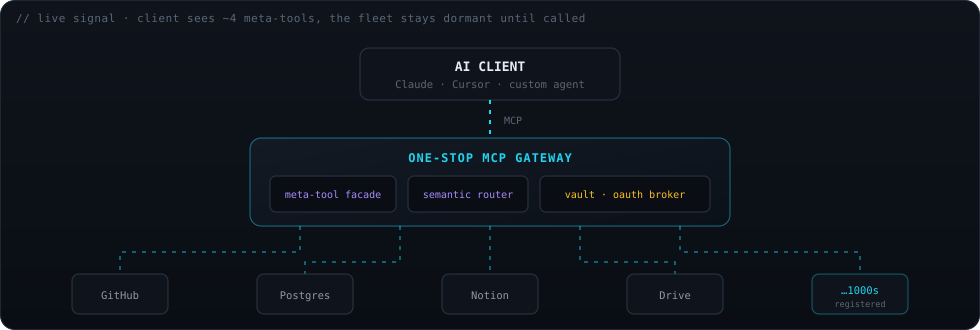

# One-Stop MCP


**Status: feature-complete against the design brief, not yet released.** Routing, the vault and OAuth broker, the 51-server seed catalog and team mode are built and tested; nothing is published to npm or a registry yet. [Details](#status).

One-Stop MCP is a gateway between one MCP client and any number of MCP servers. Connected tool definitions are re-processed, and billed, on every model request, so the cost of a session grows with how many tools you have connected rather than how much work you do. The gateway holds the client-facing surface at four fixed meta-tools regardless of how many servers sit behind it, and injects a downstream tool's full schema only when a task needs it. Because every server is reached through the gateway, it is also the one place credentials are stored and used.

[Original design brief (PDR)](docs/PDR.md) · [Architecture](docs/architecture.md) · [Security](docs/security.md) · [Deployment](docs/deployment.md)

---

## The problem: tool definitions are billed on every request

Every connected MCP server's tool catalog (names, descriptions, JSON schemas) goes into the model's context at session start. Connect enough servers and that is tens of thousands of tokens of schema before you type anything.

Inference re-processes the whole context on every request: system prompt, tool definitions, conversation so far. So you don't pay for tool definitions once. You pay for them on every request, for the entire session, and in an agent loop every tool call round trip is another request.

Your bill therefore scales with how many tools are connected, not with how much work is being done. Most of that spend buys nothing: any given request uses two or three tools out of a hundred.

**Where this came from.** The problem was found by profiling real Claude Code sessions with `/usage`: most of each session's token spend was going to re-processing context rather than to the work itself. Tool definitions are the part of that re-processing that grows with every server you connect.

### Worked example (illustrative)

These are assumptions, not measurements. Substitute your own numbers.

| assumption | value |
|---|---|
| Connected servers | 10 |
| Tools per server, average | 12, so 120 tools |
| Tokens per tool definition (name, description, schema) | 300, so 36,000 tokens |
| Model requests in the session, counting tool-call round trips | 50 |
| Gateway: `find_tools` calls | 5, spread through the session, each one an extra request (55 total) |
| Gateway: tools returned per `find_tools` call | 5 (the default `k`) × 300 tokens = 1,500 tokens |

**Connected directly:**

```text
36,000 tokens × 50 requests                                   = 1,800,000 tokens
```

**Through the gateway:**

```text
fixed surface   375 tokens × 55 requests                      =    20,625
shortlists      1,500 tokens × 160 re-reads                   =   240,000
                (a find_tools result stays in the conversation and is
                 re-read by every later request: 54 + 43 + 32 + 21 + 10)
total                                                         =   260,625 tokens
```

That is about 86% fewer tool-definition tokens for this session. At an assumed $3 per million input tokens and no caching, it is $5.40 versus $0.78.

The percentage matters less than the slope. Connect ten more servers and the direct figure doubles to 3,600,000. The gateway figure does not change, because neither the fixed surface nor the shortlist size depends on how many servers are registered.

Not counted in this example:

- Each `find_tools` call is an extra model request, and that request re-reads the rest of the conversation too. That overhead is real and is not in the numbers above.
- Schema compression is ignored; shortlists are counted at full size.
- 375 is a chars/4 estimate of the gateway's `tools/list` payload (`npm run budget`), not a tokenizer count.

**Prompt caching changes the rate, not the shape.** Where a provider caches the stable prefix of a request, re-reading tool definitions is billed at a discount instead of full price. It is still billed on every request, caches expire during pauses, and any change to the connected tool set invalidates the cached prefix. The gateway's four-tool surface caches as well, and it does not change when servers are added.

**Some clients already defer tool loading.** Where a client or model API has its own tool search, part of this cost is handled there. The gateway does it at the MCP layer, so it works the same with any client, and it is where the credential boundary below lives.

### What follows from fixing it: credential sprawl

A dozen directly connected servers means credentials spread across a dozen client configs, with no shared rotation, no audit trail, and no single place to revoke access. Once every server sits behind one gateway, every credential is used from one process. That is where the vault and OAuth broker go. See [Credentials](#credentials-vault-and-oauth-broker).

---

## How it works

<p align="center">
  
</p>

The gateway is an MCP server to the client and an MCP client to each downstream server. One binary runs in two modes: **local** (stdio to one client, one user, a loopback listener for OAuth callbacks and key entry) and **team** (Streamable HTTP at `/mcp`, per-user bearer tokens, orgs, an MFA-gated admin API). [Architecture](docs/architecture.md) has the components and request flows.

### The client-facing surface: four meta-tools

The client's `tools/list` returns these four tools and nothing else, at any catalog size. Serialized, they come to ~375 tokens (chars/4 estimate). `npm run budget` fails if the estimate exceeds 2,000, and CI runs it.

| meta-tool | what it does |
|---|---|
| `find_tools(query, k?)` | Ranks the whole catalog against a natural-language query and returns the top `k` (default 5, at most 25) tools with compressed input schemas and a confidence flag. On low confidence the list widens to `2k` and adds a category browse list instead of guessing. |
| `list_servers(filter?, category?, tag?, auth?)` | Lists registered servers: id, name, category, description, auth type, whether you are connected, whether a session is running. No schemas. |
| `invoke(server, tool, args)` | Calls one tool on one downstream server. The gateway injects the credential, checks the kill switch, records the call in the ledger, redacts known secrets from the result, and passes the result through as-is (text, images, structured content). |
| `connect_server(server)` | Starts auth: returns a link to the provider's OAuth page or to the gateway's own key-entry page. Secrets never pass through the chat. |

### Just-in-time schema injection

1. The model calls `find_tools("open an issue for this bug")`.
2. The gateway ranks every tool in its catalog. The catalog is built from tool-list snapshots in `catalog/` (and a per-install refresh with `catalog refresh`), so discovery starts no servers.
3. The top `k` tools come back with their schemas, compressed to remove JSON-schema boilerplate. This is the only way downstream schemas enter context.
4. The model picks one and calls `invoke(server, tool, args)`.
5. The gateway starts that server if it is not running, forwards the call over a pooled session, and returns the result.

### Routing

Hybrid retrieval, all local: field-weighted keyword overlap, Okapi BM25, and a dense leg (sentence embeddings from `Xenova/bge-small-en-v1.5`, run on CPU through transformers.js and cached on disk), fused with Reciprocal Rank Fusion (k = 30). On top of the fusion: an exact tool-name shortcut, an extra vote for a server the query names ("in Notion…"), and an agreement-based confidence score that decides whether to widen. The dense leg is an optional dependency; without it routing runs on the two lexical legs. Details: [docs/routing.md](docs/routing.md).

**Measured** on the shipped catalog (926 tools across 51 servers) with `npm run bench`, top-3, 2026-10-11:

| query set | keyword + BM25 | + dense |
|---|---|---|
| Held-out: 153 queries written by an author who had not seen the manifests | 90.8% (top-1 79.7%) | **96.1%** (top-1 82.4%) |
| Seed: 200 adversarial queries, many deliberately ambiguous between services | 50.5% | 61.0% |
| Original `bench/`: 34 queries over a hand-written 82-tool catalog | 82.4% | 94.1% |

The design target is 90% top-3. The held-out set is the honest measure and meets it with or without the model. Ranking costs about 40 ms per query lexically and about 90 ms with the dense leg; building the embedding cache for a fresh catalog takes about 40 s once. CI fails if the lexical numbers drop below 78% (`bench/`) or 87% (held-out).

### Lazy sessions

Registered is not running. No downstream server starts with the gateway, and discovery reads snapshots, not live servers. A server is started by the first `invoke` that needs it; the session is pooled per user and server and closed after 60 seconds idle (`ttlMs`).

### Schema compression

Shortlisted schemas pass through a compressor before they are returned. `light` (the default) removes `$schema`, `$id`, `$ref`, `title`, `examples`, `$comment`, and `additionalProperties: false`, and keeps types, properties, `required`, and enums. `aggressive` also removes descriptions. `npm run bench -- --compress` reports the savings over the catalog.

### What stays constant and what grows

| | connected directly | through the gateway |
|---|---|---|
| Tool definitions in every request | every tool from every server | 4 meta-tools, ~375 tokens |
| Schemas added per discovery | none (already all present) | up to `k`, default 5 |
| Client context cost of adding a server | grows | none |
| Where catalog size costs something | client context, on every request | gateway memory and ranking time |

---

## Credentials: vault and OAuth broker

With every server behind the gateway, every credential is used from the gateway. Holding them there, instead of in each client config, is what makes rotation, audit, and revocation possible from one place.

1. The client calls `connect_server("notion")`.
2. The gateway reads the server's auth type from its manifest.
3. For OAuth it starts an authorization-code flow with PKCE and returns the provider's link; for an API key it returns a one-time link to its own key-entry page.
4. The user approves in the browser, or types the key into that page. The callback lands on the gateway, not the client.
5. The credential is encrypted and stored in the vault, scoped to that org, user and server.
6. Later calls to that server are authenticated by the gateway.

What is built ([docs/security.md](docs/security.md) has the threat model and every detail):

- **Vault.** AES-256-GCM, one record per (org, user, server), each bound to its scope as additional authenticated data, under keys derived with HKDF from one root key. The root key comes from a generated key file (local), `OSMCP_MASTER_KEY` (team), HashiCorp Vault Transit, or AWS KMS. Storage is a local file or HashiCorp Vault KV v2. Only `node:crypto` is used.
- **Least-privilege injection.** A credential goes into the one environment variable or header its manifest names, and nowhere else. A stdio server gets a minimal environment, never a copy of the gateway's.
- **Redaction.** Injected secrets and common token shapes are replaced with `[REDACTED]` in results, errors and logs.
- **Usage ledger.** Every credential use and admin action, hash-chained and Ed25519-signed, verifiable with the public key alone (`ledger verify`). Explainable anomaly flags: bursts, bulk-shaped tools, denial rates, per-server baselines.
- **Kill switch.** Revoke everything (freeze the vault and lock down), one server, or one user. Takes effect in a running gateway at once. Re-enabling is deliberate and one at a time.
- **Rotation.** OAuth refresh is automated; API keys rotate through a provider adapter where one exists (Cloudflare first) and are guided otherwise. One credential, a group, or all, on demand or past a 90-day policy. An incident command walks the "after a scare" flow.
- **Team mode.** Orgs and users, per-user downstream sessions, no-credential stdio servers only when the operator opts in, bearer tokens stored only as hashes and revocable one at a time, admin MFA with single-use TOTP codes and a 15-minute admin session, Prometheus metrics, and an admin page.

---

## Status

**Every feature in the [design brief](docs/PDR.md) is built and tested. Nothing is published yet.** The burn-down that built it is recorded in [docs/burndown/](docs/burndown/), with every decision and its reasoning in [DECISIONS.md](docs/burndown/DECISIONS.md).

| area | evidence |
|---|---|
| Four-tool facade over stdio and Streamable HTTP | `test/gateway.test.ts`, `test/server-http.test.ts`, `test/e2e.test.ts` (spawns the real binary) |
| Startup surface under 2,000 tokens (~375) | `npm run budget` |
| Hybrid routing, fallback ladder, widen on low confidence | `test/routing.test.ts`, `test/router.test.ts`, `npm run bench` |
| Downstream stdio and Streamable HTTP, lazy pooled sessions | `test/downstream.test.ts` |
| OAuth broker and key entry, end to end through the HTTP gateway | `test/oauth.e2e.test.ts`, `test/oauth-http.e2e.test.ts` |
| Vault, key providers, redaction, rotation | `test/security.test.ts` |
| Ledger, kill switch, TOTP | `test/security-ledger.test.ts`, `test/security-kill.test.ts`, `test/security-totp.test.ts` |
| Orgs, users, tokens, admin API, CLI | `test/tenancy.test.ts`, `test/server-http.test.ts`, `test/cli.test.ts` |
| Seed catalog: 51 servers with tool snapshots and per-tool routing utterances | `servers/`, `catalog/`, `npm run validate` |
| Registry sync, catalog probe | `test/catalog-sync.test.ts`, `test/catalog-probe.test.ts` |
| Docker and Compose packaging, CI, release workflow | `Dockerfile`, `docker-compose.yml`, `.github/workflows/` |

113 tests pass and 1 is skipped (`npm test`, 2026-10-11). CI runs typecheck, tests, the token budget, the routing floors and manifest validation on every push.

**Known limits:**

- Not published to npm (`package.json` keeps `"private": true`) and no image is pushed. Releasing is a deliberate step for the maintainer.
- Many catalog manifests were written from each server's documentation and snapshotted without live credentials. Each one says how its snapshot was made; check a server before relying on it.
- On Windows the dense leg needs the Microsoft Visual C++ redistributable. Without it the gateway prints one line and routes lexically.
- Admin sessions live in memory, so restarting a team gateway asks admins for a new TOTP code.

### Quick start

Requires Node.js 22.

```bash
git clone https://github.com/Habeeb-MD-Faiz/one-stop-mcp.git
cd one-stop-mcp
npm ci
npm run build
claude mcp add one-stop -- node "$PWD/dist/index.js"   # or any MCP client, see docs/deployment.md
```

Then ask for something a catalog server does ("list my open GitHub issues"). The model finds the tool, asks you to connect the server through a link, and calls it. Team mode, Docker, TLS and client setup are in [docs/deployment.md](docs/deployment.md); every setting is in [docs/configuration.md](docs/configuration.md).

```bash
npm test           # unit and end-to-end tests
npm run budget     # startup-surface size check
npm run bench      # routing accuracy (add --dense for the embedding leg)
npm run validate   # manifests, snapshots, routing keys, bench queries
```

---

## Roadmap

| phase | scope | exit criterion | state |
|---|---|---|---|
| P0 Core | Four-tool facade; one server proxied over stdio | Startup surface under 2k tokens | Done |
| P1 Discovery | Manifests, router, just-in-time injection | 90% top-3 on the routing benchmark | Done: 96.1% held-out (90.8% without the model) |
| P2 Auth | Vault, `connect_server` OAuth flow, ledger, rotation, kill switch | An OAuth server activated entirely inside the gateway | Done: `test/oauth-http.e2e.test.ts` |
| P3 Seed | 50 server manifests, registry sync | Useful on first run | Done: 51 servers |
| P4 Team | Multi-tenant, per-user secrets, metrics | Self-hosted multi-user deployment | Done: team mode, Compose file |
| P5 Community | Docs, manifest CI validation, RFC process, governance | External PRs merging | Built; waiting on a public release |

The v1 answers to the brief's open questions are in [RFC 0001](docs/rfcs/0001-v1-open-questions.md).

---

## Contributing: add a server with one file

Adding a server is one YAML file in `servers/`, a tool-list snapshot in `catalog/`, and one PR. No gateway code changes. [docs/adding-a-server.md](docs/adding-a-server.md) walks through it.

```yaml
# servers/filesystem.yaml
id: filesystem
name: Filesystem
category: [dev, files]
description: Read, write, and search files under an allowed directory.
transport:
  type: stdio
  command: npx
  args: ["-y", "@modelcontextprotocol/server-filesystem", "/path/to/allowed/dir"]
auth:
  type: none                # none | api_key | oauth2
routing:
  examples:                 # whole-server phrasing, matched against find_tools queries
    - "read the config file in my project"
  tools:                    # per-tool utterances: the biggest lever on routing accuracy
    read_text_file: ["show me what's in config.json", "open the notes file"]
    list_directory: ["what files are in the docs folder"]
```

The manifest schema is `schema/manifest.schema.json`; `npm run validate` and the manifests workflow check every PR. Other useful contributions: held-out routing queries (written without looking at the manifests) in `bench/heldout/`, key-management adapters for rotation, and more key providers (GCP KMS, Azure Key Vault). See [CONTRIBUTING.md](CONTRIBUTING.md) and [GOVERNANCE.md](GOVERNANCE.md).

---

## Non-goals

- **Building MCP servers.** The gateway aggregates existing ones.
- **Changing or extending the MCP protocol.** Everything is built from standard messages.
- **A hosted service.** The target is self-hosted. The design should not rule out a hosted version, but none is planned.
- **A fine-tuned routing model.** Off-the-shelf retrieval and embeddings first.
- **Shrinking tool results.** The gateway reduces the cost of tool definitions. What a tool returns passes through (after redaction).

---

## MCP spec compliance

**Conforms**

- Toward the client, the gateway is a standard MCP server built on the official TypeScript SDK (`@modelcontextprotocol/sdk` ^1.30), over stdio or Streamable HTTP. It declares the `tools` capability and serves `tools/list` and `tools/call`.
- Toward each downstream server, it is a standard MCP client over stdio or Streamable HTTP. HTTP servers that need OAuth are authorized with the MCP authorization flow (PKCE, the SDK's OAuth client provider).
- There are no custom methods, capabilities, or message fields. The meta-tools are ordinary MCP tools.

**Where behavior differs from a direct connection.** These are conventions on top of the protocol, not extensions to it.

- Downstream tools are not registered with the client. Their schemas arrive as JSON text inside a `find_tools` result, and calls go through `invoke`. The client therefore cannot validate arguments against the downstream schema (the downstream server still does), and a client with per-tool permission prompts sees `invoke`, not the underlying tool.

**Not supported**

- Resources, prompts, sampling, elicitation, roots, and `notifications/tools/list_changed`. None are exposed to the client or proxied from downstream servers.

---

## License

Apache-2.0 ([LICENSE](LICENSE)). Vendored agent skills under `.claude/` carry their own licenses.

## Further reading

- [docs/PDR.md](docs/PDR.md): the original design brief (PDR v0.1, August 2026). Its styled original is [docs/PDR.html](docs/PDR.html).
- [docs/architecture.md](docs/architecture.md), [docs/routing.md](docs/routing.md), [docs/security.md](docs/security.md), [docs/configuration.md](docs/configuration.md), [docs/deployment.md](docs/deployment.md), [docs/adding-a-server.md](docs/adding-a-server.md).
- [docs/index.html](docs/index.html): a styled page of the README as it stood on 2026-09-03, before the build-out. Kept for history.
- [archive/README.md](archive/README.md): the previous developer README.
