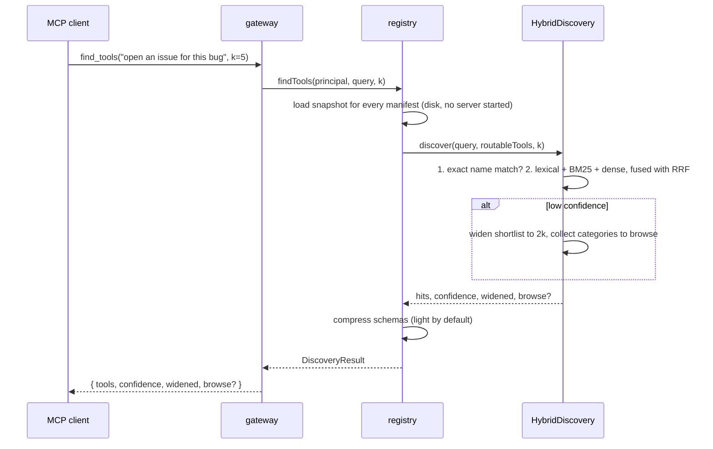

# Architecture

How One-Stop MCP is put together, what happens on each meta-tool call, and where each feature from the [design brief (PDR)](PDR.md) lives in the source tree. Decision numbers like D25 refer to the [decision log](burndown/DECISIONS.md); the answers to the design brief's nine open questions are in [RFC 0001](rfcs/0001-v1-open-questions.md).

Related: [configuration](configuration.md) · [deployment](deployment.md) · [security](security.md) · [routing](routing.md) · [adding a server](adding-a-server.md)

## The shape of it

The gateway is an MCP **server** to the client and an MCP **client** to every downstream server.

```text
                  stdio (local mode)  or  Streamable HTTP + bearer token (team mode)
 MCP client  ─────────────────────────────────────────────►  ┌──────────────────────────┐
 (Claude, Cursor, ...)        4 meta-tools, ~341 tokens       │  gateway (src/server)    │
                                                              │  find_tools list_servers │
                                                              │  invoke connect_server   │
                                                              └─────────────┬────────────┘
                                                                            │ Principal (org, user)
         ┌──────────────┬───────────────┬──────────────┬────────────────────┴──┐
         ▼              ▼               ▼              ▼                       ▼
    routing         catalog         registry         auth broker          security
  (src/routing)  (src/catalog)  (src/downstream)    (src/auth)         (src/security)
  find the tool  snapshots on   pooled sessions,   OAuth + key entry,   vault, ledger,
                 disk           lazy, TTL reaped   credential          kill switch,
                                                    injection           rotation, TOTP
                                      │
                                      ▼  stdio / Streamable HTTP (legacy SSE fallback)
                              downstream MCP servers (50 shipped in servers/)
```

Two rules shape everything:

1. **The client-facing surface is constant.** `tools/list` returns the same four meta-tools whether 5 or 5,000 servers are registered. `npm run budget` fails the build if their serialized size passes 2,000 tokens (it is about 341 by a chars/4 estimate).
2. **Discovery never starts a server.** Every server's tool list is a snapshot on disk, so `find_tools` is a local search ([D25](burndown/DECISIONS.md)). A server process starts only when `invoke` needs it.

## Components

| Component | Path | Job |
|---|---|---|
| Meta-tool facade | `src/server/gateway.ts`, `src/server/meta-tools.ts` | Builds the MCP `Server` that advertises exactly four tools and dispatches them with the caller's principal. |
| HTTP server | `src/server/http.ts` | `/mcp` (team mode), OAuth callback, key-entry pages, admin API and page, `/metrics`, `/healthz`. Plain `node:http`. |
| Metrics | `src/server/metrics.ts` | A small hand-written Prometheus text registry. |
| Admin API | `src/server/admin.ts` | One route table (kill switch, rotation, incident, ledger, users, health) used by both `/admin/api/*` and the local CLI, so both paths share input rules and every call is ledgered. |
| Composition root | `src/server/app.ts` | `createApp(config)` builds every piece below and wires them. The only place that knows all of them. |
| Tenancy | `src/tenancy/users.ts` | Users, orgs, bearer tokens (stored as SHA-256 hashes only). |
| Config and CLI | `src/config.ts`, `src/cli.ts`, `src/index.ts` | Config loading and validation; every operator command. |
| Routing | `src/routing/` | `HybridDiscovery` (exact, then lexical + BM25 + dense with reciprocal rank fusion), local embedder, on-disk embedding cache, schema compression. |
| Catalog | `src/catalog/`, `src/manifest.ts`, `schema/` | Manifest parsing and validation (`src/manifest.ts`), snapshot store, registry sync worker. |
| Downstream registry | `src/downstream/` | Lazy sessions, pooling, TTL reaping, stdio and HTTP transports, health checks, outbound credential injection, result redaction. |
| Auth broker | `src/auth/` | `connect_server` flows: OAuth (MCP authorization spec or generic OAuth 2.1 + PKCE), one-time key-entry tickets, token refresh. |
| Security | `src/security/` | Key hierarchy, encrypted secret store, HashiCorp Vault backend, signed ledger, anomaly flags, kill switch, rotation, TOTP, redaction. |
| Contracts | `src/contracts.ts`, `src/types.ts` | The interfaces between the pieces and the `Manifest` type. |

The pieces talk only through the interfaces in `src/contracts.ts` (`SecretStore`, `Ledger`, `AccessGuard`, `SessionControl`, `Discovery`, `CatalogStore`, `AuthBroker`). That is what lets a different vault backend or a different router plug in without touching the rest.

## Request flows

Every call carries a `Principal` (`{ user, org, admin }`). In local mode there is exactly one, `local`. In team mode it comes from the caller's bearer token.

### `find_tools(query, k?)`



The shortlist is the only way a downstream schema reaches the model, and it reaches it for this turn's results only. Details of the ranking are in [routing](routing.md).

### `invoke(server, tool, args)`

1. **Guard.** `AccessGuard.check(principal, server)`. The kill switch throws `AccessDeniedError` if the vault is frozen, the server is revoked, the user is revoked, or the gateway is in lockdown and the server has not been re-enabled. The denial is written to the ledger as `denied`.
2. **Credentials.** `AuthBroker.outbound(principal, manifest)` reads the caller's credential for this server from the vault and returns it as an environment variable (stdio), a header (HTTP), or an SDK auth provider (MCP-spec OAuth). If there is none, the error tells the model to call `connect_server`. A stored OAuth token that has expired is refreshed first.
3. **Session.** The registry opens a session on first use and pools it, keyed `org/user/server` (or `shared/server` for servers with `auth: none`). Idle sessions are closed after a TTL (60 seconds by default).
4. **Call.** `callTool` on the downstream server. For stdio servers the child process gets a minimal environment, never the gateway's own ([D31](burndown/DECISIONS.md)).
5. **Ledger.** One entry per call: org, user, server, tool, result. Anomaly rules run here.
6. **Redaction.** Any injected secret value is removed from the result and from errors before they go back to the model.

The first time a session opens for a server that has no snapshot, the registry saves one from the live `tools/list`.

### `connect_server(server)` with OAuth

```mermaid
sequenceDiagram
    participant U as User (browser)
    participant C as MCP client / model
    participant G as gateway
    participant V as vault
    participant A as provider authorization server
    C->>G: connect_server("notion")
    G-->>C: pending, url = authorization URL (no secret in it)
    C-->>U: "open this link"
    U->>A: approve access
    A->>U: 302 to {publicUrl}/oauth/callback?code&state
    U->>G: GET /oauth/callback
    G->>A: exchange code (PKCE verifier, state checked)
    A-->>G: access + refresh tokens
    G->>V: store, encrypted, scoped to (org, user, server)
    G->>G: ledger entry auth.connect
    G-->>U: "Connected. You can close this tab."
    Note over C,G: later invoke() calls are authenticated by the gateway; the model never sees a token
```

Three variants, chosen from the manifest:

- **HTTP server with no explicit endpoints** follows the MCP authorization spec through the SDK: discovery (RFC 9728 and RFC 8414), dynamic client registration (RFC 7591), PKCE. The registered client is stored in the vault.
- **Explicit `authorizationUrl` / `tokenUrl`** (stdio servers) uses a generic OAuth 2.1 authorization-code flow with PKCE S256 and a `state` parameter. If the manifest has no `clientId` and no client is stored, the first step is a key-entry page where the operator pastes the OAuth client id and secret.
- **`api_key`** returns a one-time ticket URL, `{publicUrl}/connect/{ticket}`. The user types the key into that page on the gateway, never into the chat. The ticket is 32 random bytes, valid 15 minutes, bound to one (org, user, server).

In-flight logins are kept in memory, so a gateway restart abandons them. The user just starts again.

### Admin actions

Kill switch, rotation, ledger and user management are **not** meta-tools ([D17](burndown/DECISIONS.md)). A model must never be able to unfreeze the vault or rotate keys. They live in the CLI, the admin HTTP API (admin bearer token plus a TOTP code) and a minimal admin page. See [security](security.md).

## Lazy sessions

Registered is not running. Nothing starts when the gateway starts. `find_tools` and `list_servers` read manifests and snapshots only. `invoke` and `health` are the only paths that open a downstream session. Sessions are pooled per scope and reaped after the TTL, so CPU and memory stay flat with a large catalog.

HTTP downstream servers are tried over Streamable HTTP first and fall back to the legacy SSE transport if the server rejects it.

## The snapshot catalog

Two files describe a server:

- `servers/<id>.yaml`, the manifest a contributor writes: transport, auth, routing examples.
- `catalog/<id>.json`, its tool list: names, descriptions, input schemas. Shipped in the repo (`source: "docs"` if written from documentation, `"live"` if captured from `tools/list`).

`one-stop-mcp catalog refresh [ids...]` captures a live list into the state directory. A snapshot in the state directory wins over the shipped one; the shipped directory is never written. `one-stop-mcp sync` imports candidate manifests from the official MCP Registry into `servers/_candidates/` for human review. Nothing is added to the live catalog automatically ([D9](burndown/DECISIONS.md)).

## Two modes, one binary

| | local | team |
|---|---|---|
| Client face | stdio | Streamable HTTP at `/mcp` |
| Gateway auth | none (one user, `local`) | per-user bearer tokens |
| HTTP listener | loopback only, for `/oauth/callback`, `/connect/*`, `/healthz` | all routes, bind address configurable |
| Master key | generated key file in the state directory | `OSMCP_MASTER_KEY` or a KMS key provider (required) |
| Operator | the person at the terminal; the CLI acts on the state directory | admins, through the CLI with `--remote` or the admin API with a TOTP code |

Mode is configuration, not a fork ([configuration](configuration.md)).

## Where each PDR feature lives

| PDR | Feature | Where |
|---|---|---|
| 4.1 | Four meta-tools, constant surface | `src/server/meta-tools.ts`, `src/server/gateway.ts`; `npm run budget` |
| 4.2 | Layer A embeddings and index; Layer B JIT schemas; fallback ladder | `src/routing/` ([routing](routing.md)) |
| 4.3 | `connect_server`, OAuth redirect, key entry, callback on the gateway | `src/auth/broker.ts`, `src/auth/vault-oauth-provider.ts`, routes in `src/server/http.ts` |
| 4.4 | Lazy sessions, pooling, TTL; schema compression | `src/downstream/registry.ts`; `src/routing/compress.ts` |
| 5 | Encryption at rest, per-user and per-org keys | `src/security/` key providers and `FileSecretStore` |
| 5 | Least-privilege injection | `AuthBroker.outbound`, registry transports, `src/security/redact.ts` |
| 5 | Admin MFA and signed audit trail | `src/security/totp.ts`, `UsageLedger`, `/admin/api/*` |
| 5 | Pluggable backend: Vault KV, Vault Transit, AWS KMS | `HashiCorpVaultStore`, `VaultTransitKeyProvider`, `AwsKmsKeyProvider` |
| 5 | Usage ledger and anomaly flagging | `UsageLedger` |
| 5 | Kill switch | `KillSwitch` |
| 5 | Rotation | `RotationService`, `AuthBroker.refresh` |
| 6 | Manifest, JSON Schema, validation | `src/manifest.ts`, `schema/manifest.schema.json`, `npm run validate` |
| 7 | 50-server seed catalog | `servers/`, `catalog/`, `bench/seed/` |
| 8 | stdio and Streamable HTTP on both faces; npx and Docker | `src/downstream/`, `src/server/http.ts`, `Dockerfile`, `docker-compose.yml` |
| 9 P3 | Registry sync worker | `src/catalog/sync.ts` |
| 9 P4 | Multi-tenant orgs and users, metrics | `src/tenancy/`, `src/server/metrics.ts` |
| 9 P5 | Docs, manifest CI, RFC process, governance | `.github/`, `docs/`, `GOVERNANCE.md` |


## What the gateway does not do

- It does not build MCP servers or extend the protocol.
- It does not shrink tool **results**. Only tool definitions are compressed; what a tool returns passes through (after redaction).
- Downstream tools are not registered with the client. The client sees `find_tools` results as JSON text and calls through `invoke`, so a client with per-tool permission prompts sees `invoke`, not the underlying tool.
